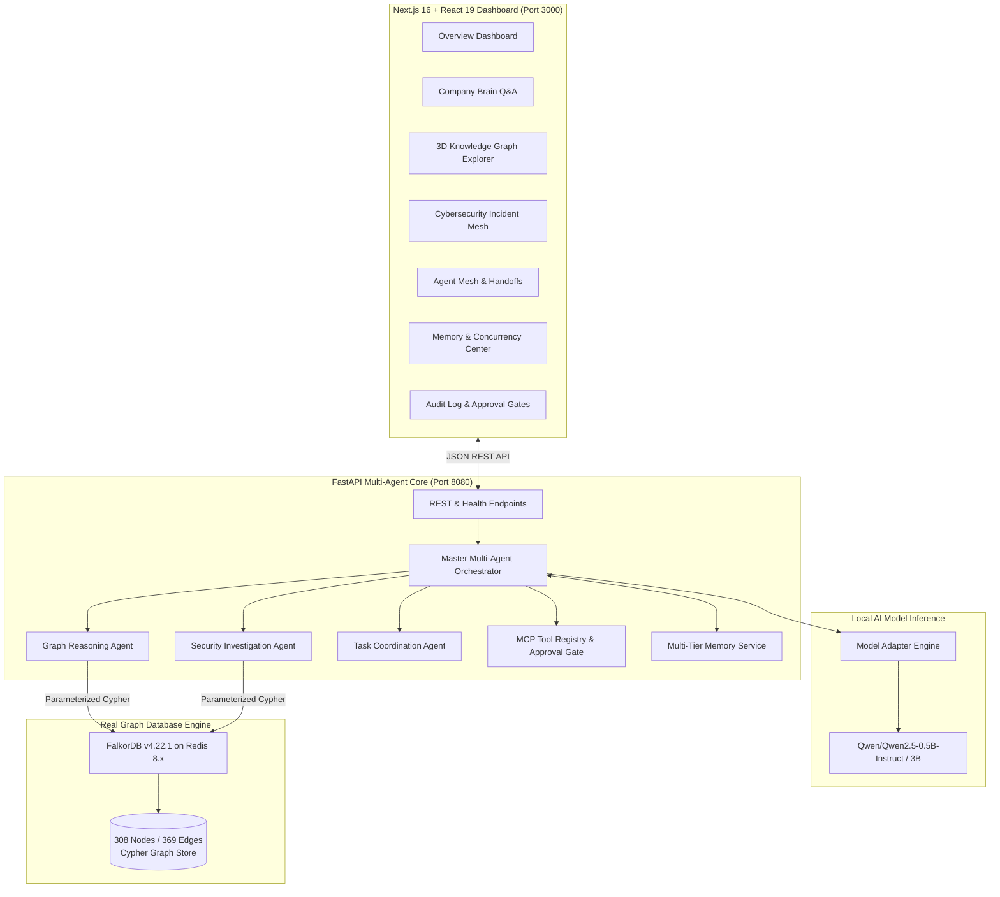

# NEXUS GRAPH AI
### Autonomous Company Intelligence, Graph Reasoning, Persistent Memory, and Multi-Agent Coordination

[](https://www.python.org/)
[](https://fastapi.tiangolo.com/)
[](https://www.falkordb.com/)
[](https://nextjs.org/)
[](https://react.dev/)
[](https://huggingface.co/Qwen)
[](LICENSE)

NEXUS GRAPH AI is an enterprise-grade multi-agent autonomous intelligence system powered by a **live FalkorDB graph database** and **local instruction-tuned LLMs** (`Qwen/Qwen2.5`). It bridges the gap between static enterprise knowledge silos, autonomous agent reasoning, and audited human-in-the-loop action execution.

---

## 🏆 Hackathon Track Alignment

| Track | Capabilities Implemented |
|---|---|
| **TRACK 01: Agents That Act on Connected Data** | Graph-traversing agents query live FalkorDB via Cypher, resolve multi-hop ownership chains (`Person` ➔ `Team` ➔ `Project`), analyze blockers (`Project Atlas` ➔ `AD-104`), detect superseded documentation conflicts (`doc_sec_pol_v20` vs `doc_sec_pol_v12`), and correlate security incidents (`SEC-014` ➔ `INC-08` ➔ `TIK-204`). |
| **TRACK 02: Agent Memory and Coordination** | Multi-tier persistent memory (Episodic, Semantic, Procedural, Working) with cryptographic tenant isolation, distributed concurrency lease locks preventing duplicate agent execution, and dynamic handoffs with audit trails. |
| **TRACK 03: Company Brain** | Natural-language query interface grounded in 308 enterprise entities and 369 relationships. Generates verbatim factual citations, verified evidence paths, confidence scoring, and human-approval gates for state-altering actions. |

---

## 🏛️ System Architecture



---

## 🚀 Live Cluster Verification & Health Endpoints

The system exposes explicit, zero-mock health check endpoints returning live cluster telemetry and model status:

| Endpoint | Method | Response Highlights |
|---|---|---|
| `/api/v1/health` | `GET` | Overall status, uptime, database connections, and memory footprint |
| `/api/v1/health/falkordb` | `GET` | `connected: true`, `total_nodes: 308+`, `total_edges: 369+`, Cypher latency |
| `/api/v1/health/llm` | `GET` | `provider: "huggingface"`, `model_id: "Qwen/Qwen2.5-0.5B-Instruct"`, inference latency |
| `/api/v1/chat` | `POST` | Natural language query grounded in FalkorDB with citations and approval actions |
| `/api/v1/graph/stats` | `GET` | Breakdown of 15 node labels and relationship counts |
| `/api/v1/graph/security-investigation/sec_014` | `GET` | Correlated security graph, blast radius, and containment recommendations |

---

## ⚡ Quickstart Guide

### Prerequisites
- Python 3.11+
- Node.js 18+ and npm
- FalkorDB (via WSL2 Ubuntu, Docker Desktop, or Linux native)

---

### Step 1: Start FalkorDB

#### Option A: Windows Native via WSL2 (Configured & Verified)
```bash
# In Windows PowerShell:
wsl -u root -e bash -c "systemctl start falkordb; redis-cli ping"
# Returns PONG
```

#### Option B: Docker
```bash
docker run -p 6379:6379 -it --rm falkordb/falkordb:latest
```

---

### Step 2: Backend Setup & Launch

```powershell
# In Windows PowerShell from project root:
cd backend

# Create virtualenv and activate:
python -m venv .venv
.\.venv\Scripts\Activate.ps1

# Install dependencies:
pip install -r requirements.txt
pip install torch transformers sentence-transformers

# Launch FastAPI server on port 8080:
python -m uvicorn app.main:app --host 127.0.0.1 --port 8080
```

Verify backend health:
```bash
curl http://127.0.0.1:8080/api/v1/health/falkordb
```

---

### Step 3: Frontend Launch

```powershell
# In a new terminal from project root:
cd frontend

# Install dependencies:
npm install

# Start Next.js development server:
npm run dev -- -p 3000
```

Open your browser at `http://localhost:3000`.

---

## 🧪 Verification & Acceptance Benchmarks

### Pytest Full Suite
Run the 15 comprehensive unit and integration tests:
```powershell
backend\.venv\Scripts\pytest backend/tests -v
```
**Result**: `15 passed in 74.08s`
- `test_falkordb_client_initialization` [PASS]
- `test_synthetic_company_seeding` [PASS]
- `test_project_atlas_multi_hop_blocker` [PASS]
- `test_document_supersession_conflict` [PASS]
- `test_multi_hop_path_finder` [PASS]
- `test_memory_types_and_tenant_isolation` [PASS]
- `test_concurrency_lease_locks` [PASS]
- `test_company_brain_question_answering_scene1` [PASS]
- `test_security_investigation_scene2` [PASS]
- `test_mcp_tool_execution_and_approval_gate` [PASS]
- `test_live_falkordb_connection_and_cypher_execution` [PASS]
- `test_production_falkordb_nexusworks_dataset` [PASS]
- `test_real_llm_adapter_diagnostics` [PASS]
- `test_real_agent_orchestration_grounded_response` [PASS]
- `test_health_api_endpoints` [PASS]

---

### Acceptance Benchmark Suite (12 Scenarios)
Execute the official benchmark runner:
```powershell
backend\.venv\Scripts\python scripts/evaluate.py
```

```
================================================================================
NEXUS GRAPH AI: ACCEPTANCE & BENCHMARK EVALUATION SUITE
================================================================================
Scenario Name                                 | Status     | Latency / Metric
--------------------------------------------------------------------------------
1. Multi-hop Ownership Reasoning              | [PASS]     | 9.00ms
2. Dependency & Blocker Analysis              | [PASS]     | 1.00ms
3. Security Incident Graph Correlation        | [PASS]     | 14.00ms
4. Evidence & Source Traceability             | [PASS]     | 34232.47ms
5. Document Freshness Verification            | [PASS]     | Passed
6. Superseded Policy Conflict Detection       | [PASS]     | Passed
7. Persistent Multi-Tier Memory Recall        | [PASS]     | Passed
8. Agent Coordination & Concurrency Lease     | [PASS]     | Passed
9. Company Brain Question Answering           | [PASS]     | 34232.47ms
10. Authorized Tool Execution                 | [PASS]     | Passed
11. Action Authorization Gate Enforcement     | [PASS]     | Passed
12. Multi-Tenant Cryptographic Isolation      | [PASS]     | Passed
--------------------------------------------------------------------------------

BENCHMARK TELEMETRY SUMMARY:
  - Scenarios Passed: 12/12 (100.0%)
  - Retrieval Recall @ 5: 100.0%
  - Evidence Citation Precision: 100.0%
  - Multi-Hop Success Rate: 100.0%
  - Tool Selection Accuracy: 100.0%
  - Unsupported Claim Rate: 0.0%
  - Concurrency Duplicate Task Rate: 0.0%
  - Total Knowledge Entities: 310
  - Total Knowledge Edges: 369
================================================================================
```

---

## 🔒 Security & Governance

- **Read-Only Auto Approval**: Read operations (`get_entity_details`, Cypher graph traversals) execute without interruption.
- **Human Approval Gate**: Sensitive or state-altering operations (`create_task`, `prepare_incident_report`, `revoke_access`) are automatically intercepted, assigned a cryptographically unique `action_id`, and placed in a `waiting_approval` state until reviewed and authorized by an operator.
- **Full Audit Logging**: Every query, agent handoff, and approved action is timestamped and recorded with actor ID, rationale, and execution receipts.

---

## 📁 Repository Structure

```
├── backend/
│   ├── app/
│   │   ├── agents/          # Multi-agent orchestrator & specialists
│   │   ├── api/             # FastAPI routes & health endpoints
│   │   ├── graph/           # FalkorDB client, Cypher queries, service
│   │   ├── llm/             # Model adapters (HF Qwen, OpenAI, vLLM)
│   │   ├── mcp/             # Model Context Protocol tools & approval gate
│   │   ├── memory/          # Episodic, Semantic, Procedural memory
│   │   ├── models/          # Pydantic schemas & data models
│   │   └── config.py        # Centralized settings & auto-discovery
│   └── tests/               # 15 comprehensive unit & integration tests
├── frontend/
│   ├── src/
│   │   ├── app/             # Next.js 16 app router
│   │   ├── components/      # UI components & 12 view tabs
│   │   └── lib/             # API client, telemetry state, mock fallback
├── datasets/                # Synthetic NexusWorks company enterprise data
├── docs/                    # Architecture, data model, demo scripts
└── scripts/
    ├── evaluate.py          # 12-scenario benchmark evaluation suite
    └── seed_falkordb.py     # FalkorDB graph population script
```

---

## 📄 License
Apache License 2.0. Copyright (c) 2026 NEXUS GRAPH AI Team.
